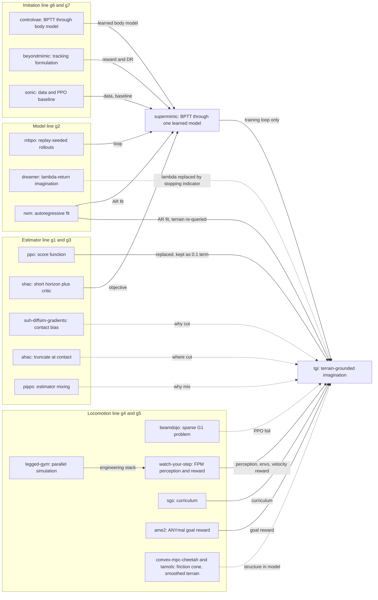

# Evolution Tree: From Classical Legged Control to PPO, Motion Imitation and TGI

This file draws the lineage analysed in the [overall report](overall-report.md) as a graph (Section 1), as a chronological ladder (Section 2), as a short account of the evolutionary logic of each branch (Section 3), and as a convergence diagram for [SuperMimic](papers/supermimic.md) and [TGI](papers/tgi.md) (Section 4). Node names are the study's paper keys; every key links to its report in the ladder table and in Section 3. Mathematics is linked to the [math cookbook](math-cookbook.md).

## 1. The tree

Solid edges mark direct inheritance (a method, objective, data source or recipe taken over and changed); dotted edges mark influence by analysis, contrast or baseline. Edge labels state what was inherited or changed. The subgraphs follow the study's groups, which are also its eras and lines.

```mermaid
graph TD
  subgraph G4["Classical control and trajectory optimisation, 1986-2024"]
    raibert["raibert 1986"]
    kajita["kajita-zmp-preview 2003"]
    capture["capture-point 2006"]
    mujoco["mujoco 2012"]
    ilqr["ilqr-online-to 2012"]
    cmpc["convex-mpc-cheetah 2018"]
    deepgait["deepgait 2019"]
    tamols["tamols 2022"]
    nmpc["perceptive-nmpc 2022"]
    dtc["dtc 2023"]
  end

  subgraph G1["Policy-gradient RL, 1992-2018"]
    reinforce["reinforce 1992"]
    pgthm["pg-theorem 1999"]
    npg["natural-pg 2001"]
    dpg["dpg 2014"]
    trpo["trpo 2015"]
    gae["gae 2015"]
    a3c["a3c 2016"]
    ddpg["ddpg 2016"]
    ppo["ppo 2017"]
    heess["heess-emergence 2017"]
    td3["td3 2018"]
    sac["sac 2018"]
  end

  subgraph G2["Model-based RL and world models, 1990-2025"]
    dyna["dyna 1990"]
    pilco["pilco 2011"]
    mbmf["nagabandi-mbmf 2017"]
    metrpo["me-trpo 2018"]
    pets["pets 2018"]
    mve["mve 2018"]
    worldmodels["world-models 2018"]
    planet["planet 2019"]
    mbpo["mbpo 2019"]
    dreamer["dreamer 2020"]
    mopo["mopo 2020"]
    dreamerv2["dreamer-v2 2021"]
    daydreamer["daydreamer 2022"]
    tdmpc["td-mpc 2022"]
    dreamerv3["dreamer-v3 2023"]
    tdmpc2["td-mpc2 2024"]
    rwm["rwm 2025"]
    rwmu["rwm-o 2025"]
  end

  subgraph G3["Analytic first-order gradients, 2015-2026"]
    svg["svg 2015"]
    pipps["pipps 2018"]
    maac["maac 2020"]
    supertrack["supertrack 2021"]
    metz["metz-gradients 2021"]
    shac["shac 2022"]
    suh["suh-diffsim-gradients 2022"]
    diffmimic["diffmimic 2023"]
    ahac["ahac 2024"]
    song["song-diffsim-quadruped 2024"]
    pwm["pwm 2025"]
    dmo["amigo-decoupled 2025"]
    onoda["onoda-composite-gradients 2026"]
  end

  subgraph G5["Learned perceptive locomotion, 2019-2025"]
    hwangbo["hwangbo-anymal 2019"]
    lee["lee-challenging-terrain 2020"]
    rma["rma 2021"]
    isaacgym["isaac-gym 2021"]
    leggedgym["legged-gym 2021"]
    miki["miki-wild 2022"]
    elevmap["elevation-mapping-gpu 2022"]
    anymalparkour["anymal-parkour 2023"]
    extremeparkour["extreme-parkour 2023"]
    radosavovic["radosavovic-humanoid 2023"]
    risky["risky-terrains 2023"]
    humanoidparkour["humanoid-parkour 2024"]
    ame["attention-map-encoding 2025"]
    beamdojo["beamdojo 2025"]
  end

  subgraph G6["Character animation by imitation, 2016-2024"]
    gail["gail 2016"]
    deepmimic["deepmimic 2018"]
    npmp["npmp 2019"]
    amp["amp 2021"]
    ase["ase 2022"]
    controlvae["controlvae 2022"]
    phc["phc 2023"]
    pulse["pulse 2024"]
    moconvq["moconvq 2024"]
    maskedmimic["maskedmimic 2024"]
  end

  subgraph G7["Humanoid tracking on robots, 2020-2026"]
    penganimals["peng-animals 2020"]
    h2o["h2o 2024"]
    exbody["exbody 2024"]
    shi["shi-mb-imitation 2024"]
    omnih2o["omnih2o 2024"]
    exbody2["exbody2 2024"]
    asap["asap 2025"]
    beyondmimic["beyondmimic 2025"]
    gmr["gmr 2025"]
    sonic["sonic 2025"]
  end

  subgraph G0["Anchor, 2026"]
    sgs["sgs 2026"]
    ame2["ame2 2026"]
    wys["watch-your-step 2026"]
    supermimic["supermimic 2026"]
    tgi["tgi 2026"]
  end

  %% classical control
  raibert -->|"template to LIPM"| kajita
  kajita -->|"divergent component"| capture
  mujoco -->|"smooth soft contact for TO"| ilqr
  raibert -->|"foothold rule"| cmpc
  cmpc -->|"SRBD plus terrain map"| tamols
  ilqr -->|"single to multiple shooting"| nmpc
  tamols -->|"TO footholds as RL targets"| dtc
  deepgait -->|"planner inside RL"| dtc

  %% policy-gradient RL
  reinforce -->|"Q in place of return"| pgthm
  pgthm -->|"Fisher metric"| npg
  npg -->|"KL constraint, line search"| trpo
  trpo -->|"clipped surrogate"| ppo
  gae -->|"advantage estimator"| ppo
  a3c -->|"parallel actors, value baseline"| ppo
  ppo -->|"distributed PPO on terrain"| heess
  pgthm -->|"deterministic limit"| dpg
  dpg -->|"replay and target networks"| ddpg
  ddpg -->|"twin critics, delayed actor"| td3
  td3 -->|"max entropy, reparameterised actor"| sac

  %% model-based RL
  dyna -->|"simulated backups from replay"| mbpo
  mbmf -->|"ensemble, BPTT abandoned"| metrpo
  mbmf -->|"probabilistic ensemble, CEM"| pets
  pets -->|"short branched rollouts"| mbpo
  mbpo -->|"uncertainty penalty, offline"| mopo
  worldmodels -->|"latent dynamics"| planet
  planet -->|"value plus gradient actor"| dreamer
  mve -->|"H-step rollout plus value"| dreamer
  dreamer -->|"categorical latents, estimator mix"| dreamerv2
  dreamerv2 -->|"score function only"| dreamerv3
  dreamerv2 -->|"real quadruped"| daydreamer
  planet -->|"decoder-free latent MPC"| tdmpc
  tdmpc -->|"scale, fixed hyperparameters"| tdmpc2
  mbpo -->|"PPO in imagination, AR fit"| rwm
  rwm -->|"ensemble penalty, offline"| rwmu
  mopo -.->|"penalty"| rwmu

  %% analytic gradients
  dpg -->|"stochastic, multi-step"| svg
  pilco -->|"particles instead of moments"| pipps
  svg -->|"H steps plus Q"| maac
  pipps -.->|"chaos diagnosis"| metz
  maac -->|"differentiable sim, h 32, TD lambda critic"| shac
  metz -.->|"truncation band"| shac
  shac -->|"adaptive horizon"| ahac
  suh -->|"truncate at stiff contact"| ahac
  shac -->|"regularised learned model"| pwm
  shac -->|"sim forward, model backward"| dmo
  shac -.->|"SRBD surrogate, real robot"| song
  suh -.->|"re-test of mixing"| onoda
  pipps -.->|"total propagation"| onoda

  %% learned locomotion
  trpo -->|"TRPO on actuator-net sim"| hwangbo
  hwangbo -->|"teacher-student, TRPO"| lee
  lee -->|"latent adaptation, PPO"| rma
  ppo -->|"PPO becomes standard"| rma
  isaacgym -->|"GPU parallelism"| leggedgym
  ppo -->|"PPO plus GAE"| leggedgym
  lee -->|"exteroception, belief gate"| miki
  elevmap -->|"deployment map"| miki
  leggedgym -->|"skill hierarchy"| anymalparkour
  leggedgym -->|"end-to-end depth"| extremeparkour
  leggedgym -->|"humanoid transfer"| radosavovic
  extremeparkour -->|"humanoid parkour"| humanoidparkour
  anymalparkour -->|"stepping stones, beams"| risky
  risky -->|"attention map encoder"| ame
  risky -->|"G1 sparse footholds"| beamdojo
  ame -->|"goal reaching, neural map"| ame2

  %% character imitation
  trpo -->|"policy optimiser"| gail
  ppo -->|"PPO plus GAE"| deepmimic
  gail -->|"transition discriminator"| amp
  deepmimic -->|"style reward"| amp
  amp -->|"skill latent"| ase
  deepmimic -->|"expert cloning"| npmp
  deepmimic -->|"dataset-scale tracking"| phc
  amp -.->|"regulariser"| phc
  phc -->|"distilled latent"| pulse
  pulse -->|"masked goals"| maskedmimic
  supertrack -->|"BPTT through body model"| controlvae
  controlvae -->|"VQ, larger data"| moconvq

  %% humanoid tracking
  deepmimic -->|"tracking to quadruped"| penganimals
  phc -->|"humanoid robot"| h2o
  h2o -->|"DAgger student"| omnih2o
  exbody -->|"full body on G1"| exbody2
  h2o -->|"delta-action alignment"| asap
  asap -->|"model, do not randomise"| beyondmimic
  beyondmimic -->|"scale one tracker"| sonic
  gmr -->|"retargeted data"| sonic
  penganimals -->|"BPTT through model on robot"| shi

  %% convergence
  mbpo -->|"replay-seeded imagination"| supermimic
  shac -->|"short horizon plus critic"| supermimic
  rwm -->|"autoregressive fit"| supermimic
  controlvae -->|"learned body model loop"| supermimic
  beyondmimic -->|"reward, actions, DR"| supermimic
  sonic -->|"data and baseline"| supermimic
  leggedgym -->|"parallel PPO recipe"| wys
  miki -->|"elevation perception"| wys
  raibert -.->|"foothold heuristic"| wys
  ame2 -.->|"baseline"| wys
  leggedgym -->|"curriculum"| sgs
  supermimic -->|"training loop"| tgi
  wys -->|"FPM perception, envs, reward"| tgi
  rwm -->|"AR fit, terrain re-queried"| tgi
  sgs -->|"curriculum"| tgi
  ame2 -->|"ANYmal goal reward"| tgi
  suh -.->|"motivates event cut"| tgi
  ahac -.->|"truncate at contact"| tgi
  dreamer -.->|"lambda recursion, stopping indicator"| tgi
  pipps -.->|"estimator mixing"| tgi
  beamdojo -.->|"same G1 sparse problem"| tgi
  tamols -.->|"smoothed terrain fields"| tgi
  cmpc -.->|"friction cone in model"| tgi
```

## 2. The ladder

Each rung is a step at which a problem left open by an earlier rung was addressed by a new key idea. Rungs are ordered by the year in which the idea first appeared; several rungs run in parallel, which the "Line" column makes explicit (g4 classical control, g1 policy-gradient RL, g2 model-based RL, g3 analytic gradients, g5 perceptive locomotion, g6/g7 imitation, g0 anchor).

| Rung | Years | Line | Method(s) | Problem left open by the previous rung | Key idea | Governing equation | What the next rung fixes |
|---|---|---|---|---|---|---|---|
| 1 | 1986–2006 | g4 | [raibert](papers/raibert.md), [kajita-zmp-preview](papers/kajita-zmp-preview.md), [capture-point](papers/capture-point.md) | Full hybrid floating-base dynamics are intractable for online control | Reduce to a template model and enforce a stability criterion; foot placement as the balance actuator | $p = x - \tfrac{z_c}{g}\ddot x,\quad x_{cp} = x + \dot x/\omega$ ([m-lipm-zmp](math-cookbook.md#m-lipm-zmp), [m-slip](math-cookbook.md#m-slip)) | Templates discard whole-body dynamics; rung 3 optimises through the full model |
| 2 | 1990–2001 | g1, g2 | [reinforce](papers/reinforce.md), [pg-theorem](papers/pg-theorem.md), [natural-pg](papers/natural-pg.md), [dyna](papers/dyna.md) | Controllers are designed by hand; nothing is learned from reward | Estimate the policy gradient from sampled returns without differentiating the environment; reuse a model for simulated backups | $\nabla_\theta J = \mathbb E\big[\nabla_\theta\log\pi_\theta(a\mid s)\,Q^\pi(s,a)\big]$ ([m-pg-theorem](math-cookbook.md#m-pg-theorem)) | High variance and unsafe step sizes; rung 4 adds baselines, advantages and trust regions |
| 3 | 2011–2018 | g4, g2 | [ilqr-online-to](papers/ilqr-online-to.md), [mujoco](papers/mujoco.md), [pilco](papers/pilco.md), [convex-mpc-cheetah](papers/convex-mpc-cheetah.md) | Templates and heuristics ignore whole-body dynamics | Differentiate an explicit model (exact rigid body, Gaussian process, or linearised SRBD) and optimise over a receding horizon | $V_x = \ell_x + f_x^\top V'_x$ (iLQR backward pass) ([m-lqr-ddp](math-cookbook.md#m-lqr-ddp), [m-mpc](math-cookbook.md#m-mpc), [m-centroidal-srbd](math-cookbook.md#m-centroidal-srbd)) | Online solves are costly and model errors are failure modes on hardware; GP models do not scale to contact. Rungs 8 and 10 learn controllers instead |
| 4 | 2014–2018 | g1 | [trpo](papers/trpo.md), [gae](papers/gae.md), [a3c](papers/a3c.md), [ppo](papers/ppo.md), [heess-emergence](papers/heess-emergence.md); off-policy [dpg](papers/dpg.md), [ddpg](papers/ddpg.md), [td3](papers/td3.md), [sac](papers/sac.md) | Vanilla policy gradients are noisy and unstable | Advantage estimation plus KL-bounded or clipped steps; or a one-step pathwise gradient through a learned critic | $L^{\text{clip}} = \mathbb E\big[\min(r_t\hat A_t,\ \mathrm{clip}(r_t,1\pm\epsilon)\hat A_t)\big]$ ([m-ppo-clip](math-cookbook.md#m-ppo-clip), [m-advantage-gae](math-cookbook.md#m-advantage-gae), [m-trust-region](math-cookbook.md#m-trust-region)) | Sample cost and no robots; rung 8 moves to hardware, rung 5 uses dynamics derivatives |
| 5 | 2015–2020 | g3 | [svg](papers/svg.md), [maac](papers/maac.md), [pipps](papers/pipps.md) | Score-function estimators ignore known derivatives and scale badly with action dimension | Reparameterise actions and backpropagate returns through a (learned) model; bootstrap with a critic | $J_H = \mathbb E\big[\textstyle\sum_{t<H}\gamma^t r_t + \gamma^H Q(s_H,a_H)\big]$ ([m-reparam](math-cookbook.md#m-reparam), [m-variance-scaling](math-cookbook.md#m-variance-scaling)) | Gradients explode through chaotic dynamics over long horizons; rung 11 truncates |
| 6 | 2017–2020 | g2 | [nagabandi-mbmf](papers/nagabandi-mbmf.md), [me-trpo](papers/me-trpo.md), [pets](papers/pets.md), [mve](papers/mve.md), [world-models](papers/world-models.md), [mbpo](papers/mbpo.md), [mopo](papers/mopo.md) | Model-free RL is sample-inefficient | Neural dynamics models used for planning or data generation, with ensembles and short branched rollouts against exploitation | One-step vs multi-step model loss; MBPO return bound ([m-model-learning](math-cookbook.md#m-model-learning), [m-ensembles](math-cookbook.md#m-ensembles), [m-dyna-mbpo](math-cookbook.md#m-dyna-mbpo)) | BPTT through models reported to fail (ME-TRPO, PETS); rung 7 makes gradient-based imagination work in latent space |
| 7 | 2019–2024 | g2 | [planet](papers/planet.md), [dreamer](papers/dreamer.md), [dreamer-v2](papers/dreamer-v2.md), [daydreamer](papers/daydreamer.md), [dreamer-v3](papers/dreamer-v3.md), [td-mpc](papers/td-mpc.md), [td-mpc2](papers/td-mpc2.md) | Planning at decision time is costly; pixel inputs need latent models | Actor–critic trained in latent imagination on λ-returns; or latent MPC with a terminal Q | $V_\lambda(s_t) = r_t + \gamma\big[(1-\lambda)v(s_{t+1}) + \lambda V_\lambda(s_{t+1})\big]$ ([m-rssm-elbo](math-cookbook.md#m-rssm-elbo), [m-lambda-return](math-cookbook.md#m-lambda-return)) | Generic latents and learned rewards; DreamerV3 abandons pathwise gradients. Rung 13 builds robot-specific models |
| 8 | 2018–2021 | g6 | [gail](papers/gail.md), [deepmimic](papers/deepmimic.md), [npmp](papers/npmp.md), [amp](papers/amp.md) | Hand-designed character controllers do not reproduce natural motion | Track mocap with exponential-kernel rewards, reference state initialisation and early termination under PPO; or adversarial style rewards | $r_t = \sum_s w_s\exp(-k_s\lVert\hat x^s_t - x^s_t\rVert^2)$ ([m-tracking-reward](math-cookbook.md#m-tracking-reward), [m-adversarial-imitation](math-cookbook.md#m-adversarial-imitation)) | One policy per clip, no robots; rungs 12 and 14 scale and transfer |
| 9 | 2019–2021 | g5 | [hwangbo-anymal](papers/hwangbo-anymal.md), [lee-challenging-terrain](papers/lee-challenging-terrain.md) (both TRPO), [rma](papers/rma.md), [isaac-gym](papers/isaac-gym.md), [legged-gym](papers/legged-gym.md) (PPO) | Model-based controllers are brittle on real terrain; simulation is not the robot | Actuator networks, privileged teacher–student training, domain randomisation; then massively parallel PPO on one GPU | $\nabla_\theta J = \mathbb E\big[\sum_t\nabla_\theta\log\pi_\theta(a_t\mid o_t)\hat A_t\big]$ with DR over $\xi$ ([m-domain-rand](math-cookbook.md#m-domain-rand), [m-pd-actuator](math-cookbook.md#m-pd-actuator), [m-curriculum](math-cookbook.md#m-curriculum)) | Blind robots cannot choose footholds; rung 10 adds perception |
| 10 | 2020–2025 | g5, g4 | [miki-wild](papers/miki-wild.md), [elevation-mapping-gpu](papers/elevation-mapping-gpu.md), [anymal-parkour](papers/anymal-parkour.md), [extreme-parkour](papers/extreme-parkour.md), [radosavovic-humanoid](papers/radosavovic-humanoid.md), [humanoid-parkour](papers/humanoid-parkour.md), [risky-terrains](papers/risky-terrains.md), [attention-map-encoding](papers/attention-map-encoding.md), [beamdojo](papers/beamdojo.md); hybrids [deepgait](papers/deepgait.md), [tamols](papers/tamols.md), [perceptive-nmpc](papers/perceptive-nmpc.md), [dtc](papers/dtc.md) | Perception and foothold choice; sparse terrain | Heightmap or attention encoders, noise models, two-stage training, dense foothold rewards, multiple critics; or TO footholds as RL targets | Bilinear heightmap queries; per-group advantages ([m-terrain-lookup](math-cookbook.md#m-terrain-lookup), [m-attention](math-cookbook.md#m-attention), [m-multi-critic](math-cookbook.md#m-multi-critic), [m-shooting](math-cookbook.md#m-shooting)) | On sparse terrain plain PPO fails (BeamDojo Table II: 0.33 % stones, 0.67 % beams); rung 16 changes perception, rung 18 the estimator |
| 11 | 2018–2022 | g3 | [pipps](papers/pipps.md), [metz-gradients](papers/metz-gradients.md), [shac](papers/shac.md) | Pathwise gradients explode over long horizons (chaos) | Truncate to short windows and close them with a critic trained on TD(λ) targets | $J_h = \sum_{t<h}\gamma^t r_t + \gamma^h V(s_h)$ ([m-short-horizon](math-cookbook.md#m-short-horizon), [m-bptt](math-cookbook.md#m-bptt)) | Contact makes first-order gradients biased; rung 15 analyses and adapts |
| 12 | 2021–2024 | g6, g3 | [supertrack](papers/supertrack.md), [controlvae](papers/controlvae.md), [moconvq](papers/moconvq.md), [diffmimic](papers/diffmimic.md), [phc](papers/phc.md), [pulse](papers/pulse.md), [ase](papers/ase.md), [maskedmimic](papers/maskedmimic.md) | PPO trackers cost $10^8$–$10^{10}$ samples; latent spaces lack coverage | Backpropagate tracking or reconstruction losses through a learned body model (single GPU); or distil PPO trackers into latent spaces | Multi-step autoregressive model loss; ELBO with learned prior ([m-model-learning](math-cookbook.md#m-model-learning), [m-latent-skills](math-cookbook.md#m-latent-skills), [m-distillation](math-cookbook.md#m-distillation)) | Critic-free, myopic, flat ground, no robots; rung 17 adds a critic and hardware |
| 13 | 2025 | g2 | [rwm](papers/rwm.md), [rwm-o](papers/rwm-o.md) | Generic world models compound error over long robot rollouts | Train a robot world model on its own autoregressive predictions; PPO in imagination; uncertainty penalty offline | $\mathcal L = \sum_{j=1}^{N}\lVert\hat s_j - s_j\rVert^2$, $\hat s_{j+1} = f(\hat s_j, a_j)$ ([m-model-learning](math-cookbook.md#m-model-learning)) | SHAC through the model fails; rung 17 shows when first-order imagination works |
| 14 | 2020–2026 | g7 | [peng-animals](papers/peng-animals.md), [h2o](papers/h2o.md), [exbody](papers/exbody.md), [omnih2o](papers/omnih2o.md), [exbody2](papers/exbody2.md), [asap](papers/asap.md), [beyondmimic](papers/beyondmimic.md), [gmr](papers/gmr.md), [sonic](papers/sonic.md), [shi-mb-imitation](papers/shi-mb-imitation.md) | Character trackers assume ideal actuators and full observability | Retargeting, deployable observations, DAgger students, delta-action alignment, correct actuator modelling, then scale | Tracking reward with PD set-points $\theta^{sp} = \theta_0 + \alpha\odot a$ ([m-retargeting](math-cookbook.md#m-retargeting), [m-residual-dynamics](math-cookbook.md#m-residual-dynamics), [m-pd-actuator](math-cookbook.md#m-pd-actuator)) | About 21,000 GPU-hours for one PPO tracker (SONIC); rung 17 replaces the estimator |
| 15 | 2022–2026 | g3 | [suh-diffsim-gradients](papers/suh-diffsim-gradients.md), [ahac](papers/ahac.md), [song-diffsim-quadruped](papers/song-diffsim-quadruped.md), [pwm](papers/pwm.md), [amigo-decoupled](papers/amigo-decoupled.md), [onoda-composite-gradients](papers/onoda-composite-gradients.md) | First-order gradients through contact are biased or high-variance | Diagnose bias at discontinuities; truncate at stiff contact; smooth with learned models; mix estimators | $\bar\nabla^{[\alpha]}F = \alpha\bar\nabla^{[1]}F + (1-\alpha)\bar\nabla^{[0]}F$ ([m-contact-gradients](math-cookbook.md#m-contact-gradients), [m-estimator-mixing](math-cookbook.md#m-estimator-mixing)) | Not tested on terrain with geometric discontinuities; rung 18 targets that |
| 16 | 2026 | g0 | [watch-your-step](papers/watch-your-step.md), [sgs](papers/sgs.md), [ame2](papers/ame2.md) | Dense map perception is costly and slows learning; uniform task sampling wastes environments | Gate perception to patches around predicted footholds; success-guided task sampling | FPM $f_\theta:\mathbb R^{70}\to\mathbb R^4$ trained by Huber regression ([m-terrain-lookup](math-cookbook.md#m-terrain-lookup), [m-curriculum](math-cookbook.md#m-curriculum)) | Still PPO; rung 18 keeps the perception and replaces the estimator |
| 17 | 2026 | g0 | [supermimic](papers/supermimic.md) | PPO's cost on large motion libraries; critic-free model-based methods are myopic | One deterministic $\xi$-conditioned world model; BPTT over $H=32$ imagined steps with survival weights and a critic | $\hat J = \mathbb E\big[\sum_{t<H}\gamma^t\hat c_t\hat r_{t+1} + \gamma^H\hat c_H V_\psi(\hat s_H)\big]$ ([m-short-horizon](math-cookbook.md#m-short-horizon)) | Flat ground only; no terrain or object interaction |
| 18 | 2026 | g0 | [tgi](papers/tgi.md) | Sparse terrain makes dynamics and pathwise gradients discontinuous | Terrain read from the simulator; contact-structured model; event-gated stopping-time truncation; fixed-weight hybrid estimator (pathwise + 0.1 × likelihood ratio) | $G_t = r_t + \gamma(1-d_t)\big[(1-\ell_t)V(s_{t+1}) + \ell_t G_{t+1}\big]$ ([m-stopping-time-truncation](math-cookbook.md#m-stopping-time-truncation), [m-straight-through](math-cookbook.md#m-straight-through), [m-rigid-contact](math-cookbook.md#m-rigid-contact)) | Open: no paper, no numbers, no hardware ([overall report §9](overall-report.md#9-open-research-questions)) |

## 3. The evolutionary logic of each branch

### 3.1 Classical control (g4)

The classical branch evolves by enlarging what the model contains. [raibert](papers/raibert.md) controls hopping height, speed and attitude with decoupled feedback laws on a spring-mass intuition; [kajita-zmp-preview](papers/kajita-zmp-preview.md) and [capture-point](papers/capture-point.md) formalise balance on the linear inverted pendulum; [ilqr-online-to](papers/ilqr-online-to.md), on the smooth contact model of [mujoco](papers/mujoco.md), optimises the full rigid body online; [convex-mpc-cheetah](papers/convex-mpc-cheetah.md) retreats to a single rigid body to run on hardware; [tamols](papers/tamols.md) and [perceptive-nmpc](papers/perceptive-nmpc.md) bring terrain into the optimiser. Each step either adds dynamics or adds environment, and each pays with solver cost or model assumptions that become failure modes. The hybrids [deepgait](papers/deepgait.md) and [dtc](papers/dtc.md) mark the point where the branch began to hand parts of the problem to learning. What it passes forward is structural: the adjoint recursion that reverse-mode differentiation reuses, the finite-horizon cost with a terminal value, the friction cone and centre-of-pressure constraints that TGI builds into its model, and the smoothed terrain fields that make height maps differentiable. Detail: [g4](groups/g4-classical-control.md).

### 3.2 Policy-gradient RL (g1)

The score-function branch evolves by refining two things around a fixed estimator: the weight multiplying the score ([reinforce](papers/reinforce.md)'s return, [pg-theorem](papers/pg-theorem.md)'s $Q^\pi$, [a3c](papers/a3c.md)'s n-step advantage, [gae](papers/gae.md)'s λ-weighted advantage) and the step control ([natural-pg](papers/natural-pg.md)'s Fisher metric, [trpo](papers/trpo.md)'s KL constraint, [ppo](papers/ppo.md)'s clip). [heess-emergence](papers/heess-emergence.md) was the first to apply the result to procedurally generated terrain. The off-policy branch ([dpg](papers/dpg.md), [ddpg](papers/ddpg.md), [td3](papers/td3.md), [sac](papers/sac.md)) evolves by controlling critic error, and is already first-order one step deep; it is the conceptual bridge to g3. PPO won the legged-robot niche not on sample efficiency but because parallel simulation made samples cheap and PPO is indifferent to how the environment is built. Detail: [g1](groups/g1-rl-foundations.md).

### 3.3 Model-based RL (g2)

The model-based branch evolves along three axes: how the model is used, what it is, and how compounding error is controlled. From [dyna](papers/dyna.md)'s length-one backups and [pilco](papers/pilco.md)'s analytic gradients, neural models ([nagabandi-mbmf](papers/nagabandi-mbmf.md)) brought scalability and exposed compounding error; [me-trpo](papers/me-trpo.md) and [pets](papers/pets.md) reported that gradients through them failed, and the branch moved to data generation ([mbpo](papers/mbpo.md), [mopo](papers/mopo.md)) and planning ([pets](papers/pets.md), [planet](papers/planet.md), [td-mpc](papers/td-mpc.md), [td-mpc2](papers/td-mpc2.md)). [mve](papers/mve.md) and [world-models](papers/world-models.md) supplied the rollout-plus-value decomposition and the warning about exploitation. [dreamer](papers/dreamer.md) restored gradient-based imagination in latent space, [dreamer-v2](papers/dreamer-v2.md) and [daydreamer](papers/daydreamer.md) kept it for continuous control and real robots, and [dreamer-v3](papers/dreamer-v3.md) dropped it. [rwm](papers/rwm.md) and [rwm-o](papers/rwm-o.md) brought autoregressive training to robot models but used PPO in imagination after SHAC failed through the model. Detail: [g2](groups/g2-world-models.md).

### 3.4 Analytic gradients (g3)

The first-order branch evolves as a sequence of diagnoses and fixes. [svg](papers/svg.md) introduces the estimator; [pipps](papers/pipps.md) and [metz-gradients](papers/metz-gradients.md) diagnose chaos-driven variance over long horizons; [maac](papers/maac.md) and [shac](papers/shac.md) fix it with short horizons and a terminal critic; [suh-diffsim-gradients](papers/suh-diffsim-gradients.md) diagnoses bias at contact discontinuities; [ahac](papers/ahac.md) truncates at stiff contact; [pwm](papers/pwm.md) argues that learned models smooth usefully, [amigo-decoupled](papers/amigo-decoupled.md) that model Jacobians are better evaluated at true states; [onoda-composite-gradients](papers/onoda-composite-gradients.md) re-tests estimator mixing. [song-diffsim-quadruped](papers/song-diffsim-quadruped.md) and [diffmimic](papers/diffmimic.md) show the approach on a real quadruped and on characters, and [supertrack](papers/supertrack.md) starts the learned-model line in graphics. Detail: [g3](groups/g3-analytic-gradients.md).

### 3.5 Perceptive locomotion (g5)

The locomotion branch evolves by adding devices around PPO: an actuator network ([hwangbo-anymal](papers/hwangbo-anymal.md), TRPO), privileged teacher–student training ([lee-challenging-terrain](papers/lee-challenging-terrain.md), TRPO; [rma](papers/rma.md), PPO), GPU parallelism ([isaac-gym](papers/isaac-gym.md), [legged-gym](papers/legged-gym.md)), robust exteroception ([miki-wild](papers/miki-wild.md), [elevation-mapping-gpu](papers/elevation-mapping-gpu.md)), agility ([anymal-parkour](papers/anymal-parkour.md), [extreme-parkour](papers/extreme-parkour.md)), humanoids ([radosavovic-humanoid](papers/radosavovic-humanoid.md), [humanoid-parkour](papers/humanoid-parkour.md)) and sparse footholds ([risky-terrains](papers/risky-terrains.md), [attention-map-encoding](papers/attention-map-encoding.md), [beamdojo](papers/beamdojo.md)). The last step strains the recipe: plain PPO with the right reward reaches 0.33 % success on BeamDojo's hard stepping stones, and every success adds curricula, two-stage training and hand-designed geometric rewards. The strain is attributable to the estimator, which is why this branch hands its engineering stack, but not its optimiser, to TGI. Detail: [g5](groups/g5-learned-locomotion.md).

### 3.6 Motion imitation (g6, g7)

The imitation branch evolves on three independent axes: the imitation signal (tracking reward in [deepmimic](papers/deepmimic.md), discriminator in [gail](papers/gail.md), [amp](papers/amp.md), [ase](papers/ase.md), reconstruction in [controlvae](papers/controlvae.md)), the optimiser (PPO almost everywhere; BPTT through a learned model in [controlvae](papers/controlvae.md), [moconvq](papers/moconvq.md), [shi-mb-imitation](papers/shi-mb-imitation.md); SVG(0) in [npmp](papers/npmp.md)) and the interface (clip, latent skill, masked goal: [phc](papers/phc.md), [pulse](papers/pulse.md), [maskedmimic](papers/maskedmimic.md)). On robots, [peng-animals](papers/peng-animals.md) transfers tracking to a quadruped; [h2o](papers/h2o.md), [exbody](papers/exbody.md), [omnih2o](papers/omnih2o.md) and [exbody2](papers/exbody2.md) solve deployability; [asap](papers/asap.md) aligns dynamics; [beyondmimic](papers/beyondmimic.md) compresses the formulation; [gmr](papers/gmr.md) fixes retargeting; [sonic](papers/sonic.md) scales one PPO tracker to about 21,000 GPU-hours. The branch passes SuperMimic its whole formulation except the optimiser. Detail: [g6](groups/g6-character-imitation.md), [g7](groups/g7-humanoid-tracking.md).

## 4. Convergence in SuperMimic and TGI

The branches meet in two steps. [SuperMimic](papers/supermimic.md) joins the model-based loop of the imitation strand (SuperTrack, ControlVAE) to SHAC's critic-bootstrapped objective and RWM's autoregressive fitting, on BeyondMimic's tracking formulation and SONIC's data, and shows that first-order optimisation through one learned body model beats cluster-scale PPO on flat-ground tracking. [TGI](papers/tgi.md) keeps that loop, drops the tracking task in favour of Watch Your Step's velocity-commanded perceptive locomotion (and AME-2's goal reaching on ANYmal), and adds the devices that sparse terrain requires. The motion-imitation lineage therefore reaches TGI only through SuperMimic's training loop, not through its objective.

The convergence can be summarised as an inventory of what each line contributes to TGI's final objective. The estimator line supplies the short-horizon return with terminal critic ([m-short-horizon](math-cookbook.md#m-short-horizon)), the reason to stop the pathwise chain at contact ([m-contact-gradients](math-cookbook.md#m-contact-gradients)) and the reason to keep a small zeroth-order term ([m-estimator-mixing](math-cookbook.md#m-estimator-mixing)); TGI turns these into the event-gated recursion above, a stopping-time truncation in which the remainder of the return after a poorly supported touchdown is replaced by the critic's value of the post-touchdown state ([m-stopping-time-truncation](math-cookbook.md#m-stopping-time-truncation)), plus a likelihood-ratio term of fixed weight 0.1. The model line supplies replay-seeded imagination, the λ-return critic and autoregressive fitting ([m-dyna-mbpo](math-cookbook.md#m-dyna-mbpo), [m-lambda-return](math-cookbook.md#m-lambda-return), [m-model-learning](math-cookbook.md#m-model-learning)). The classical line supplies the contact structure and smoothed terrain fields ([m-rigid-contact](math-cookbook.md#m-rigid-contact), [m-terrain-lookup](math-cookbook.md#m-terrain-lookup)). The locomotion line supplies simulation, perception, curriculum and the task. The imitation line supplies, through SuperMimic, the evidence that the loop works at scale when the reward is smooth. Whether it works when the terrain is not is the open question recorded in the [overall report](overall-report.md#71-backpropagation-through-learned-models-failure-abandonment-and-success-without-a-common-test).
