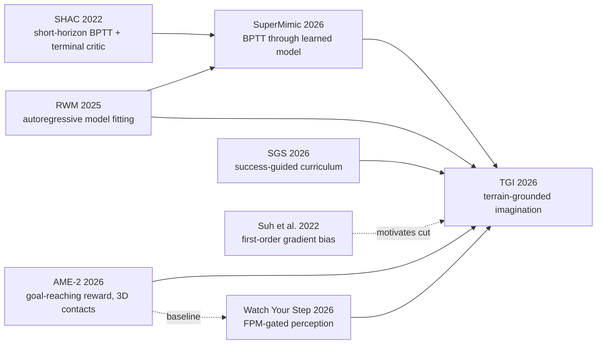

# g0-anchor: TGI and its direct parents

This group holds the target work, [Terrain-Grounded Imagination (TGI)](../papers/tgi.md), and its two named parents from 2026: [SuperMimic](../papers/supermimic.md), which supplies the training scheme, and [Watch Your Step](../papers/watch-your-step.md), which supplies perception and environments. Two papers enter by depth-3 continuation because the TGI code uses them directly: [SGS](../papers/sgs.md) for the curriculum and [AME-2](../papers/ame2.md) for the ANYmal reward. The report also serves as the map of the study. It places TGI on the four predecessors its README names, [SuperMimic](../papers/supermimic.md), [Watch Your Step](../papers/watch-your-step.md), [SHAC](../papers/shac.md) and [Robotic World Model](../papers/rwm.md), and links from each component to the group that traces its history.

## 1. The problem

All three core works address one question from different directions: how to obtain a legged controller that is both capable on hard terrain and cheap to train. The dominant answer in 2021–2025 was model-free [PPO](../papers/ppo.md) at massive parallelism ([Legged Gym](../papers/legged-gym.md)), with dense elevation maps or learned map encoders for perception ([Miki et al.](../papers/miki-wild.md), [AME-1](../papers/attention-map-encoding.md), [AME-2](../papers/ame2.md)). It is expensive in two separate ways. On the optimisation side, likelihood-ratio gradients need many samples, which is why [SONIC](../papers/sonic.md) spends about 21,000 GPU-hours on motion tracking and AME-2 about 60 RTX-4090-days on locomotion. On the perception side, the policy must discover which part of a large map matters while it is still learning to walk.

SuperMimic attacks the first cost by replacing the estimator: it fits a deterministic differentiable world model to simulator transitions and backpropagates a short imagined return through it, so that one model of the body amortises learning across a motion library. Watch Your Step attacks the second by replacing the observation: a blind foothold prediction model (FPM) decides where to look, and the policy sees only two 7×7 patches. TGI combines the two, and in doing so meets a problem neither parent faced, namely that sparse terrain makes the dynamics, and therefore the pathwise gradient, discontinuous where it matters most.

## 2. Map: how TGI sits on its predecessors

The four named predecessors contribute separable components, and each change TGI makes to them answers a specific failure mode.

| Component | Source | What TGI keeps | What TGI changes, and why |
|---|---|---|---|
| Policy objective | [SHAC](../papers/shac.md) | $H$-step return backpropagated through dynamics, plus $\gamma^H V(s_H)$; λ-return critic | Learned model instead of a differentiable simulator; no target critic (following SuperMimic). The horizon is truncated at poorly supported touchdowns, because first-order gradients through those contacts are biased ([Suh et al.](../papers/suh-diffsim-gradients.md)). A score-function term with weight 0.1 is added. |
| Training loop | [SuperMimic](../papers/supermimic.md) | Replay buffer, deterministic model conditioned on the randomisation context $\xi$, $k=8$, $H=32$, utd 0.4, λ = 0.95 | Reward, observation and termination heads become analytic functions of state and simulator terrain. The model gains an exact contact structure, $J^\top W$ with geometry-gated forces. Model-predicted forces enter the reward as an impact penalty. |
| Model fitting | [RWM](../papers/rwm.md) | Multi-step autoregressive loss, so the model learns to correct its own compounding error | Terrain features and contact geometry are re-queried from the *predicted* state at each step of the window, so the model learns how its own drift changes contact. |
| Perception and environments | [Watch Your Step](../papers/watch-your-step.md) | FPM, 201-dimensional observation, 7×7 patches, drift and noise, G1 environments, validation suites | The FPM is trained continually rather than refit from scratch every 500 iterations. The scan is recomputed inside imagination. Foothold-support rewards are added, because pathwise gradients need dense differentiable signals. |

Two further borrowings are not named in the README but are explicit in the code: the [SGS](../papers/sgs.md) sampler (`tgi/env/sgs.py`), extended with a neighbour bound across difficulty levels, and [AME-2](../papers/ame2.md)'s goal-reaching reward for ANYmal (`tgi_anymal/mdp/mdp.py`), transcribed into a differentiable form.

## 3. Chronological development

The algorithmic spine is older than the group. [SVG](../papers/svg.md) (2015) and [PIPPS](../papers/pipps.md) (2019) established pathwise policy gradients through learned and probabilistic models ([reparameterisation](../math-cookbook.md#m-reparam)). [MAAC](../papers/maac.md) (2020) bootstrapped them with a learned Q-function. [SHAC](../papers/shac.md) (2022) showed that truncating BPTT to $h=32$ steps with a terminal critic tames the exploding, chaotic gradients of long horizons in a differentiable simulator ([BPTT](../math-cookbook.md#m-bptt), [short horizon](../math-cookbook.md#m-short-horizon)). In the same year, [Suh et al.](../papers/suh-diffsim-gradients.md) showed that the same first-order gradients are biased through stiff contact. [RWM](../papers/rwm.md) (2025) trained robot world models autoregressively for long PPO rollouts in imagination ([model learning](../math-cookbook.md#m-model-learning)). On the perception side, [Miki et al.](../papers/miki-wild.md) (2022) established elevation-map locomotion, and [AME-1](../papers/attention-map-encoding.md) (2025) and [AME-2](../papers/ame2.md) (early 2026) learned attention over the map.

The three core works then appear within weeks of one another in autumn 2026. SGS (8 October) makes massive-scale PPO effective with a success-guided curriculum. Watch Your Step (21 October) introduces foothold-gated perception. SuperMimic (v3, 19 November) shows that BPTT through one learned model can beat cluster-scale PPO on humanoid tracking on one GPU, and lists terrain as future work. TGI, released with code but without a paper, supplies that terrain extension using the perception of its own authors' earlier paper.

## 4. Comparison of the group's methods

| | [SuperMimic](../papers/supermimic.md) | [Watch Your Step](../papers/watch-your-step.md) | [TGI](../papers/tgi.md) | [SGS](../papers/sgs.md) | [AME-2](../papers/ame2.md) |
|---|---|---|---|---|---|
| Gradient estimator | Pathwise (BPTT through model) + terminal critic | Score function (PPO, GAE) | Pathwise, event-gated, + 0.1 × score function + critic | Score function (PPO) | Score function (PPO) + distillation |
| Model | Learned deterministic MLP 3×2048; learned reward, observation and termination heads | none | Learned deterministic MLP 3×1024 with exact contact Jacobian and geometry gate; analytic reward and terminations | none | none |
| Terrain in training | flat floor | heightmap, FPM-gated patches; full map to critic | exact simulator heightmap (G1) or 3D column distance field (ANYmal) in model, reward, critic; FPM patches to policy | procedural, 13 types | ground-truth map (teacher), neural map (student) |
| Data | 4096 envs, replay 1000 steps per env | 8192 envs on-policy | 8192 (G1) / 4096 (ANYmal) envs, replay 200 steps per env | up to $2^{20}$ envs on-policy | 8 GPUs |
| Horizon | $H=32$ imagined, $k=8$ fit | full episodes, GAE | $H\le32$ (cut at events), $k=8$ fit | full episodes | full episodes |
| Robot / task | G1, 129,514-motion tracking | G1, velocity on sparse terrain | G1 velocity; ANYmal goal-reaching with climbing | ANYmal-D multi-terrain; assembly | ANYmal-D, TRON1 |
| Reported cost | 3 h on 1 H100 to pass SONIC | 0.55 s per update on 1 RTX 3090 | about 7.5 h (G1) / 5.6 h (ANYmal) on 1 RTX PRO 6000 | about 36 h at 1M envs | about 60 RTX-4090-days |
| Sim-to-real | G1 hardware (4 motions) | G1 hardware, zero-shot | MuJoCo sim-to-sim scripts; no hardware reported | assembly hardware (RGB distillation) | ANYmal and TRON1 hardware |

The table shows TGI's distinctive position: it is the only work in the group whose optimiser differentiates through contact *with terrain*, and the only one without reported quantitative results.

## 5. Shared mathematics

The group rests on six pieces of mathematics, each developed in the cookbook. The imagined objective of SuperMimic and TGI is SHAC's truncated return with a terminal value ([short horizon](../math-cookbook.md#m-short-horizon)); TGI's version is a stopping-time truncation,
$$G_0=\sum_{t=0}^{\tau}\gamma^t\bar c_t r_t+\gamma^{\tau+1}\bar c_{\tau+1}V_\psi(s_{\tau+1}),$$
with $\tau$ the first poorly supported touchdown or $H-1$. The critics of all three core works use [λ-returns](../math-cookbook.md#m-lambda-return) and [GAE](../math-cookbook.md#m-advantage-gae). Model fitting is the multi-step autoregressive loss ([model learning](../math-cookbook.md#m-model-learning)). TGI's model mirrors the rigid-body equation $M\ddot q+h=S^\top\tau+J_c^\top\lambda$ by learning $M^{-1}$-like and free-motion terms while computing $J^\top$ exactly ([rigid contact](../math-cookbook.md#m-rigid-contact)). The terrain enters through bilinear heightmap queries, straight-through estimators and blurred support fields ([terrain lookup](../math-cookbook.md#m-terrain-lookup)). The rationale for the gradient cut is the bias of first-order estimators through discontinuities ([contact gradients](../math-cookbook.md#m-contact-gradients)). Watch Your Step and AME-2 add privileged critics and teacher–student training ([domain randomisation](../math-cookbook.md#m-domain-rand)), and SGS adds Beta-kernel success-guided sampling ([curriculum](../math-cookbook.md#m-curriculum)).

## 6. Tensions and open problems

**Exact forward, surrogate backward.** TGI's decision to read terrain from the simulator makes imagination exact where a learned model would blur, but an exact step function has no useful derivative. TGI therefore pairs every exact forward quantity with a designed backward surrogate: a sigmoid contact gate with 1 cm temperature, a straight-through unsupported share, and a Gaussian-blurred support field with σ = 5 cm. Its gradients are those of a hand-smoothed problem, not of the true one, and the smoothing bandwidths act as hidden hyperparameters that decide how far a gradient can "see" a stone. This is the [randomised-smoothing](../math-cookbook.md#m-contact-gradients) idea of Suh et al. applied deterministically and by hand.

**Which bias to accept.** SuperMimic shows that BPTT beats PPO by about 64× in imagined steps when the dynamics are benign. TGI accepts model and contact bias in exchange for that efficiency, then removes the worst of it with the event gate, replacing it with critic bias, and re-admits a small score-function term. The resulting estimator mixes three sources of error. None is ablated publicly, although the repository contains a finite-difference gradient checker designed to measure exactly this.

**Perception versus differentiability.** Watch Your Step's gate is a rounding operation, and TGI leaves it non-differentiable, so the policy gradient ignores how the next observation depends on the next state. The FPM's blindness, which is its virtue in WYS, also means that imagination cannot teach the policy to look elsewhere. The policy can only learn to step where the FPM already predicts.

**Foothold rewards.** AME-2 argues that foothold rewards cannot be terrain-agnostic and omits them. WYS also omits them and lets the gated observation shape foot placement. TGI reintroduces explicit foothold-support, edge and flatness rewards because a pathwise optimiser needs a dense differentiable signal at the foot. Whether this restricts the gaits TGI can discover (for example, near-edge footholds during climbing) is open.

**Evidence.** SuperMimic and WYS report controlled comparisons and hardware transfer. TGI reports only training times and animations. The group's central claim, that BPTT through a terrain-grounded model is a viable recipe for sparse-terrain locomotion, therefore rests on code and design rationale rather than on measurement.

## 7. How the group feeds the rest of the study and TGI

Every other group traces one strand that converges here. [g1-rl-foundations](g1-rl-foundations.md) supplies the score-function and actor–critic background that TGI partly replaces ([PPO](../papers/ppo.md), [GAE](../papers/gae.md)) and partly keeps (critic, λ-returns, the 0.1 likelihood-ratio term). [g2-world-models](g2-world-models.md) traces learned dynamics from [Dyna](../papers/dyna.md) and [PILCO](../papers/pilco.md) through [MBPO](../papers/mbpo.md), [Dreamer](../papers/dreamer.md) and [RWM](../papers/rwm.md), the lineage of TGI's model and replay-seeded imagination. [g3-analytic-gradients](g3-analytic-gradients.md) traces the pathwise estimator from [SVG](../papers/svg.md) to [SHAC](../papers/shac.md), [AHAC](../papers/ahac.md), [PWM](../papers/pwm.md) and [DMO](../papers/amigo-decoupled.md), including the contact-bias analysis of [Suh et al.](../papers/suh-diffsim-gradients.md) that motivates the cut. [g4-classical-control](g4-classical-control.md) supplies the rigid-body contact model whose $J^\top\lambda$ structure TGI hard-codes, and the foothold-planning tradition (including [Raibert](../papers/raibert.md)'s heuristic) that WYS turns into a learned predictor. [g5-learned-locomotion](g5-learned-locomotion.md) supplies the environments, terrain curricula, elevation-map perception and sim-to-real practice ([Legged Gym](../papers/legged-gym.md), [Miki et al.](../papers/miki-wild.md), [BeamDojo](../papers/beamdojo.md)). [g6-character-imitation](g6-character-imitation.md) and [g7-humanoid-tracking](g7-humanoid-tracking.md) supply the motion-tracking setting in which SuperMimic was developed ([DeepMimic](../papers/deepmimic.md), [ControlVAE](../papers/controlvae.md), [BeyondMimic](../papers/beyondmimic.md), [SONIC](../papers/sonic.md)) and whose dense, smooth rewards explain why SuperMimic did not need TGI's gate.

## Corpus additions

| Key | arXiv | Reason |
|---|---|---|
| `sgs` | 2610.12465 | TGI's terrain curriculum (`tgi/env/sgs.py`, `tgi_anymal/env/sgs.py`) implements its sampler and cites it. No other group covers adaptive task sampling. |
| `ame2` | 2601.08485 | The strongest baseline in Watch Your Step, and the source of TGI-ANYmal's goal-reaching reward and non-foot-contact view of locomotion. It extends `attention-map-encoding` (g5), which covers only AME-1. |
